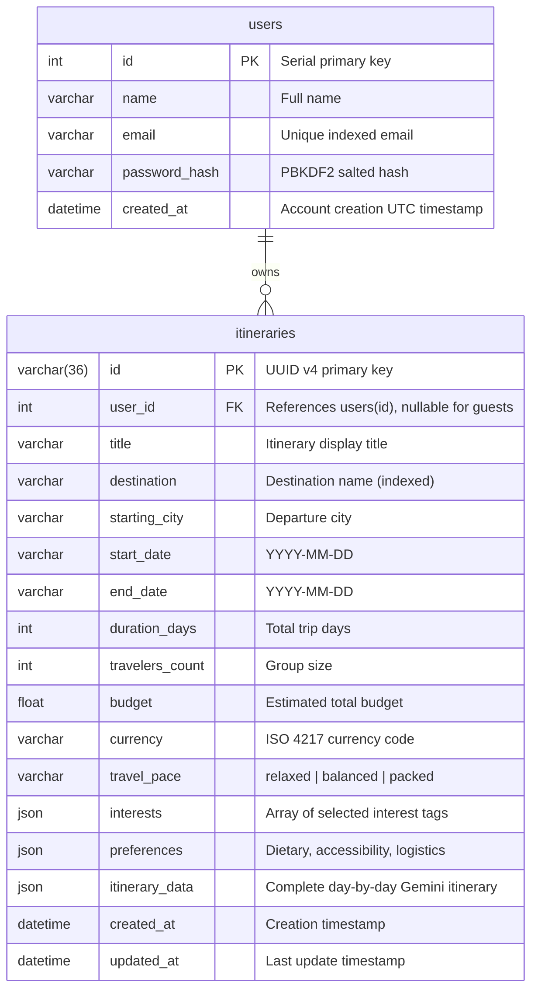

# Database Schema — Neon PostgreSQL

TripGenius AI uses PostgreSQL hosted on **Neon** via SQLAlchemy 2.0 ORM. The relational models are normalized with JSON/JSONB support for multi-day unstructured itinerary objects.

---

## 1. Entity Relationship Diagram

---

## 2. Table Specifications

### `users` Table
Stores authenticated account credentials and metadata.

| Column | Type | Constraints | Description |
| :--- | :--- | :--- | :--- |
| `id` | `INTEGER` | `PRIMARY KEY AUTOINCREMENT` | Unique identifier |
| `name` | `VARCHAR(120)` | `NOT NULL` | User full name |
| `email` | `VARCHAR(255)` | `NOT NULL, UNIQUE, INDEX` | Login email address |
| `password_hash` | `VARCHAR(255)` | `NOT NULL` | PBKDF2 hash (never plaintext) |
| `created_at` | `DATETIME / TIMESTAMP` | `NOT NULL, DEFAULT UTC` | Creation timestamp |

### `itineraries` Table
Stores generated and saved travel itineraries.

| Column | Type | Constraints | Description |
| :--- | :--- | :--- | :--- |
| `id` | `VARCHAR(36)` | `PRIMARY KEY` | UUID v4 string |
| `user_id` | `INTEGER` | `FOREIGN KEY (users.id) ON DELETE CASCADE, NULLABLE, INDEX` | Owning user (null for guest trips) |
| `title` | `VARCHAR(255)` | `NOT NULL` | Display title |
| `destination` | `VARCHAR(255)` | `NOT NULL, INDEX` | Destination city/country |
| `starting_city` | `VARCHAR(255)` | `NULLABLE` | Departure origin |
| `start_date` | `VARCHAR(50)` | `NOT NULL` | Departure date |
| `end_date` | `VARCHAR(50)` | `NOT NULL` | Return date |
| `duration_days` | `INTEGER` | `NOT NULL, DEFAULT 1` | Duration count |
| `travelers_count`| `INTEGER` | `NOT NULL, DEFAULT 1` | Traveler count |
| `budget` | `FLOAT` | `NOT NULL, DEFAULT 0.0` | Budget amount |
| `currency` | `VARCHAR(10)` | `NOT NULL, DEFAULT 'USD'` | Currency code |
| `travel_pace` | `VARCHAR(50)` | `NOT NULL, DEFAULT 'balanced'` | Pace selection |
| `interests` | `JSON / JSONB`| `NULLABLE` | Tags array |
| `preferences` | `JSON / JSONB`| `NULLABLE` | Custom constraints |
| `itinerary_data`| `JSON / JSONB`| `NOT NULL` | Full structured schedule |
| `created_at` | `DATETIME / TIMESTAMP` | `NOT NULL, DEFAULT UTC` | Creation timestamp |
| `updated_at` | `DATETIME / TIMESTAMP` | `NOT NULL, DEFAULT UTC` | Last edit timestamp |

---

## 3. Database Resilience & SSL on Neon
Neon PostgreSQL connections require TLS encryption (`sslmode=require`).
In `backend/config.py`:
- SQLAlchemy connection URL format is dynamically verified: `postgresql://...`
- Engine options enable connection pool pre-pinging (`pool_pre_ping=True`) and recycling (`pool_recycle=300`) to prevent dropped serverless connections.
- When `DATABASE_URL` is omitted, the backend falls back safely to local SQLite (`sqlite:///tripgenius.db`).
